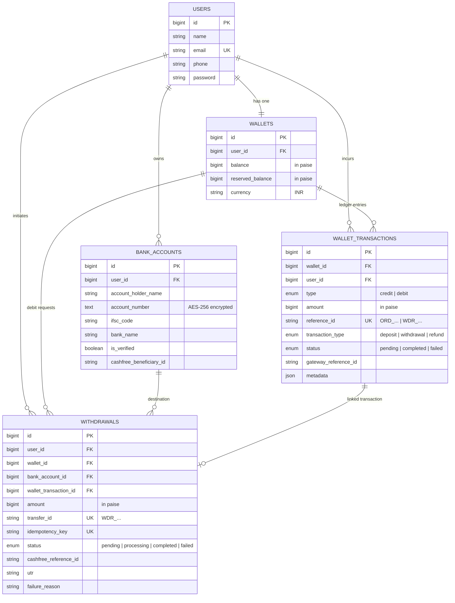
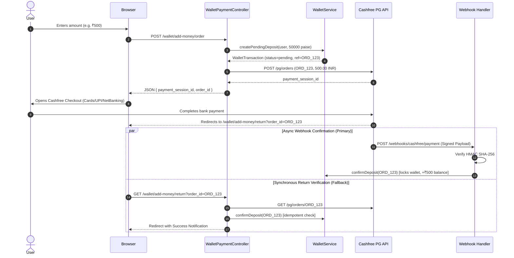
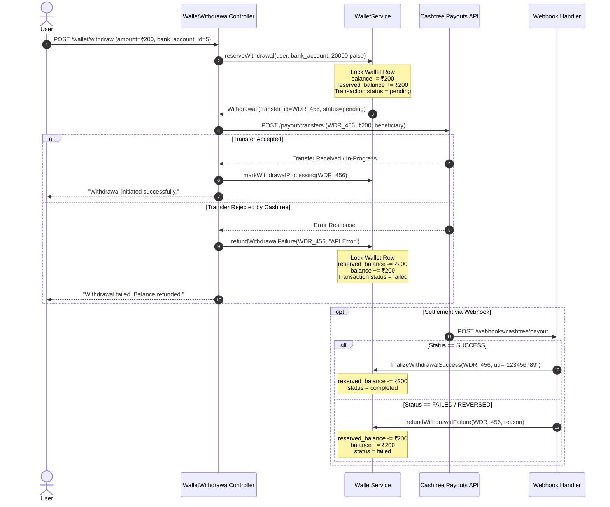

# WalletPay — Digital Wallet & Cashfree Integration System
## Complete End-to-End Technical Documentation & Senior Engineer Presentation Guide

---

## 1. Executive Summary

**WalletPay** is a production-grade, double-entry digital wallet system built on **Laravel 12 / PHP 8.2+** integrated with **Cashfree Payments (Payment Gateway v2025-01-01 and Payouts V2 v2024-01-01)**. 

The application enables authenticated users to:
1. **Deposit Money:** Load wallet balance seamlessly using Cards, UPI, Net Banking, and Wallets via Cashfree PG.
2. **Verify Bank Accounts:** Securely register bank accounts with real-time IFSC validation and automated Cashfree Penny-Drop verification.
3. **Withdraw Funds:** Transfer wallet balance directly to verified bank accounts via Cashfree Payouts (IMPS / NEFT / RTGS).
4. **Audit & Reconcile:** Maintain a tamper-evident financial ledger with real-time balance tracking, pending state management, and HMAC-signed webhook synchronization.

---

## 2. Core Architectural & Fintech Principles

When explaining this project to a Senior Engineer or Tech Lead, emphasize these **four core architectural pillars**:

```
+---------------------------------------------------------------------------------------+
|                                CORE FINTECH PILLARS                                   |
+---------------------------------------------------------------------------------------+
| 1. Pure Integer Math (Paise)  | Zero floating-point rounding errors (IEEE 754).       |
| 2. Pessimistic Row Locking    | SELECT ... FOR UPDATE prevents race-conditions.      |
| 3. Two-Phase Balance Reserve  | Balance -> Reserved -> Settled or Refunded.          |
| 4. Cryptographic Verification | HMAC SHA-256 webhook signatures + AES-256 at rest.   |
+---------------------------------------------------------------------------------------+
```

### Pillar 1: Pure Integer Arithmetic (Zero Floating-Point Drift)
- In financial software, using floating-point types (`float`, `double`) causes catastrophic precision loss (e.g. `0.1 + 0.2 = 0.30000000000000004`).
- **Our Implementation:** All monetary fields in the database (`wallets.balance`, `wallets.reserved_balance`, `wallet_transactions.amount`, `withdrawals.amount`) are stored as **64-bit unsigned integers in Paise** (1 INR = 100 Paise).
- Conversion to human-readable Rupees occurs **only at the presentation/API boundary** via `Wallet::formatPaise()` and `Wallet::paiseToRupees()`.

### Pillar 2: Pessimistic Concurrency & ACID Integrity
- If a user clicks "Withdraw" twice in rapid succession (or submits concurrent requests), a naive system allows balance overdraft.
- **Our Implementation:** All wallet balance changes execute inside `DB::transaction()` wrapped in **pessimistic row locking** (`Wallet::where('id', $walletId)->lockForUpdate()->firstOrFail()`).
- Database engine holds an exclusive row-level lock until the transaction commits, ensuring sequential, deterministic mutations.

### Pillar 3: Two-Phase Balance Reservation for Payouts
- External bank transfers are asynchronous and can take seconds, hours, or fail midway.
- Instead of immediately deducting funds or leaving funds vulnerable to double-spending:
  1. **Phase 1 (Reserve):** On withdrawal initiation, funds move from `balance` to `reserved_balance` (`balance -= amount; reserved_balance += amount;`). The user cannot spend these funds, but they remain accounted for.
  2. **Phase 2 (Settlement / Rollback):**
     - **On SUCCESS webhook/sync:** `reserved_balance -= amount;` and withdrawal is marked `COMPLETED`.
     - **On FAILED/REVERSED webhook/sync:** `reserved_balance -= amount; balance += amount;` — the funds are atomically restored to the user's available balance with an audit log.

### Pillar 4: Security, Encryption & Webhook Verification
- **Bank Data At Rest:** Bank account numbers are encrypted at rest using Laravel's AES-256-CBC envelope encryption (`'account_number' => 'encrypted'`).
- **Display Masking:** Full bank account numbers are never exposed in logs or UI (`masked_account_number` yields `•••• 1234`).
- **HMAC SHA-256 Webhooks:** Cashfree webhooks must pass cryptographic signature validation (`VerifyCashfreeWebhookSignature` middleware) with timestamp freshness checks to prevent replay attacks.

---

## 3. Database Schema & Entity Relationships



---

## 4. Key Components & Code Walkthrough

### 4.1 Configuration Layer (`config/cashfree.php`)
- Centralized configuration for **Payment Gateway**, **Payouts V2**, and **Bank Account Verification**.
- Automatically switches between `https://sandbox.cashfree.com` and `https://api.cashfree.com` based on `CASHFREE_ENV`.
- Configures transfer modes, webhook secrets, timeout tolerances, and minimum/maximum transaction limits (₹1.00 min to ₹1,00,000.00 max).

---

### 4.2 Services Layer

#### A. `WalletService` (`app/Services/WalletService.php`)
The heart of financial operations. Contains no external HTTP calls — purely handles internal state, database locking, and financial integrity:
- `getDashboardSummary()`: Gathers available balance, reserved balance, total deposits, total withdrawals, and recent activity.
- `createPendingDeposit()`: Validates deposit limits and creates a `pending` credit transaction with an idempotency reference (`ORD_YYYYMMDDHHIISS_RANDOM`).
- `confirmDeposit()`: Re-checks paid amount against expected amount, locks the wallet row, increments balance, and updates status to `completed`.
- `reserveWithdrawal()`: Validates available balance, reserves balance atomically (`balance -= amount; reserved_balance += amount;`), and creates pending withdrawal and debit transaction records.
- `finalizeWithdrawalSuccess()`: Deducts reserved balance permanently upon bank confirmation.
- `refundWithdrawalFailure()`: Restores reserved balance back to available balance upon bank failure or reversal.

#### B. `CashfreePaymentService` (`app/Services/CashfreePaymentService.php`)
Handles communication with Cashfree Payment Gateway (PG API v2025-01-01):
- `createOrder()`: Initiates `/pg/orders` on Cashfree with order ID, amount in INR, customer details, and return URL. Returns a `payment_session_id` used by Cashfree Web Checkout SDK.
- `getOrder()`: Fetches order status server-side from `/pg/orders/{order_id}`.
- `getOrderPayments()`: Fetches payment attempts and gateway reference IDs.
- `verifySignature()`: Validates webhook signatures using HMAC SHA-256 over raw payload and timestamp headers.

#### C. `CashfreePayoutService` (`app/Services/CashfreePayoutService.php`)
Handles communication with Cashfree Payouts V2 & Verification APIs:
- `verifyBankAccountSync()`: Calls `/verification/bank-account/sync` to perform penny-drop verification, ensuring bank account number and IFSC are active before any payout.
- `createBeneficiary()`: Registers verified bank account under `/payout/beneficiary`.
- `requestTransfer()`: Initiates standard bank transfer via `/payout/transfers`.
- `getTransferStatus()`: Fetches live status and UTR (Unique Transaction Reference) for a transfer.

---

### 4.3 Middleware Layer (`VerifyCashfreeWebhookSignature.php`)
Intercepts all incoming webhook calls from Cashfree (`/webhooks/cashfree/payment` and `/webhooks/cashfree/payout`):
1. Reads raw HTTP request body (preserves byte sequence).
2. Extracts headers: `X-Webhook-Signature` and `X-Webhook-Timestamp`.
3. Verifies timestamp age (rejects requests older than 300 seconds to protect against replay attacks).
4. Computes HMAC SHA-256 hash: `base64_encode(hash_hmac('sha256', $timestamp . $rawBody, $secret, true))`.
5. Rejects untrusted or forged requests with HTTP 401 Unauthorized before any business logic executes.

---

## 5. End-to-End Operational Workflows

### Flow 1: Add Money (Deposit Flow)



---

### Flow 2: Withdraw Funds (Two-Phase Payout Flow)



---

## 6. How to Present This to Your Senior Employee / Tech Lead

When asked to explain the project in a technical review, follow this structured presentation script:

### Step 1: High-Level Purpose (The Elevator Pitch)
> *"This project is an enterprise-grade digital wallet built on Laravel 12 that handles customer deposits, bank account verifications, and payouts using Cashfree's latest APIs. It's engineered specifically to adhere to fintech standards: zero precision loss, total protection against double-spending, and resilient asynchronous settlement."*

### Step 2: The Money Handling Architecture (Fintech Integrity)
> *"The first design decision we made is that **we never use floats for money**. All balances, transactions, and limits are stored in the database as 64-bit integer paise. ₹1.00 is represented as 100 paise. Rupees only exist when formatted for the UI or Cashfree's API.*
>
> *Second, every balance alteration uses **pessimistic database row locks (`SELECT ... FOR UPDATE`) inside atomic database transactions**. If a user triggers concurrent requests or double-clicks, the database engine queues them sequentially. Overdrafts and race conditions are mathematically impossible."*

### Step 3: Handling Payouts Safely (Two-Phase Reserve Pattern)
> *"For withdrawals, we implemented a **two-phase reservation pattern**:*
> *When a withdrawal is requested, funds don't vanish immediately, nor do they stay available to spend. We move the funds from `available_balance` to `reserved_balance`. The user cannot spend them.*
> *If the bank confirms the transfer via webhook or polling, the reserved balance is finalized and cleared.*
> *If the bank rejects or reverses the transfer, the system automatically releases the reserved balance back to the available balance and logs the failure reason."*

### Step 4: Security & Compliance
> *"On the security front:*
> 1. *Bank account numbers are encrypted at rest using AES-256 and only displayed masked (`•••• 1234`).*
> 2. *Bank accounts undergo automated Penny-Drop verification via Cashfree Verification API before withdrawals are permitted.*
> 3. *All Cashfree Webhooks pass through custom middleware verifying HMAC SHA-256 signatures with timestamp expiration checks to eliminate replay attacks.*
> 4. *Every withdrawal request supports unique idempotency keys."*

---

## 7. Senior Engineer Interview / Q&A Preparation

| Potential Senior Question | Recommended Technical Answer |
|---|---|
| **"What happens if Cashfree confirms a deposit via webhook, but the user's return URL also hits verify?"** | *"Both endpoints call `WalletService::confirmDeposit()`. It uses pessimistic locking and checks if the transaction is already `STATUS_COMPLETED`. If it is already completed, it returns immediately without incrementing the balance a second time. It is completely idempotent."* |
| **"Why did you use `reserved_balance` instead of just deducting the balance on withdrawal?"** | *"Because bank transfers are asynchronous. If we deduct immediately and the payout fails, we have to invent an artificial 'refund' transaction that complicates accounting. If we don't deduct, the user can double-spend the money before the transfer clears. Moving funds into `reserved_balance` accurately reflects real-world banking escrows."* |
| **"How do you protect against webhook replay attacks?"** | *"The `VerifyCashfreeWebhookSignature` middleware checks the `X-Webhook-Timestamp` header. If the timestamp is older than 5 minutes (300 seconds), it is immediately rejected, preventing malicious actors from resending captured payloads."* |
| **"How are bank accounts validated?"** | *"First, client and server-side Regex verifies the standard RBI IFSC pattern (`^[A-Z]{4}0[A-Z0-9]{6}$`). Then, `CashfreePayoutService::verifyBankAccountSync()` executes a real-time Penny Drop API call. The account is only marked `is_verified=true` if Cashfree returns `ACCOUNT_IS_VALID`."* |

---

## 8. Exporting This Guide to PDF

You can easily generate a PDF to share with your senior team lead using any of the following methods:

### Method A: Direct Browser Print (Easiest & Best Looking)
1. Open this file or preview it in your markdown reader / browser.
2. Press **Ctrl + P** (Print).
3. Select **"Save as PDF"** as the destination.
4. Set Margins to **"Default"** or **"Minimum"**, enable **"Background graphics"**, and click **Save**.

### Method B: Using VS Code Markdown PDF Extension
1. Install the extension **Markdown PDF** (`yzane.markdown-pdf`).
2. Open this document in VS Code.
3. Right-click anywhere in the editor and choose **Markdown PDF: Export (pdf)**.
4. A cleanly styled PDF will be generated in the same directory.
